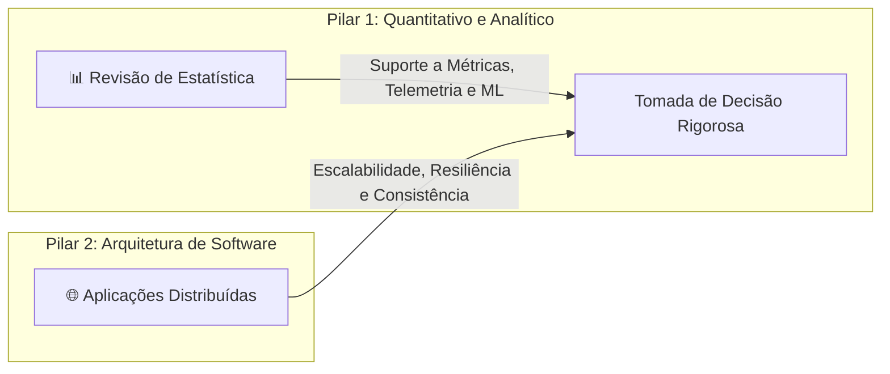
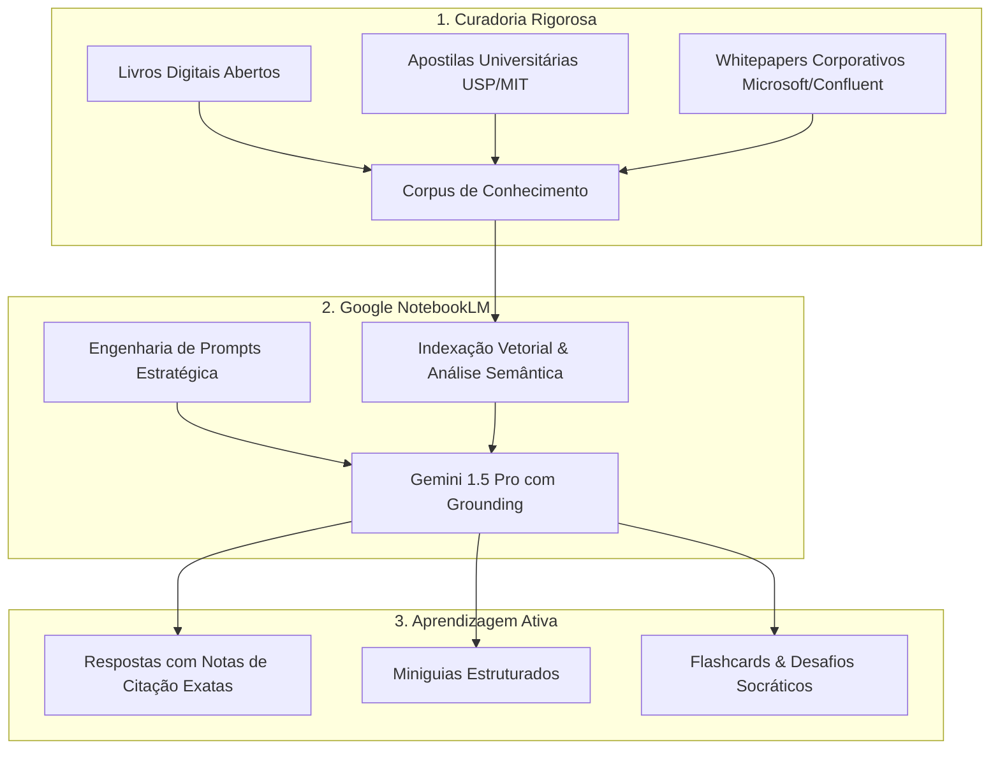

<div align="center">

# 🧠 Mini-Guia de Estudos com Google NotebookLM
### *Aprendizagem Ativa, Curadoria Crítica e Engenharia de Prompts com IA Ancorada*

[](https://www.dio.me/)
[](https://notebooklm.google.com/)
[](LICENSE)
[](https://github.com/JoaoFrois01/mini-guia-estudos-notebooklm)

<p align="center">
  <b>Cadernos Temáticos de Alto Desempenho:</b><br/>
  📊 <b>Revisão de Estatística</b> &bull; 🌐 <b>Desenvolvimento de Aplicações Distribuídas</b>
</p>

</div>

---

## 📌 Sumário Executivo

1. [🎯 Contexto e Objetivos de Aprendizagem](#-contexto-e-objetivos-de-aprendizagem)
2. [🔗 Acesso Direto aos Cadernos no NotebookLM](#-acesso-direto-aos-cadernos-no-notebooklm)
3. [🧠 Metodologia: O NotebookLM como Segundo Cérebro (Grounding RAG)](#-metodologia-o-notebooklm-como-segundo-cérebro-grounding-rag)
4. [📚 Curadoria de Fontes de Dados Abertas](#-curadoria-de-fontes-de-dados-abertas)
5. [⚡ Engenharia de Prompts e "Cicatrizes" (Troubleshooting)](#-engenharia-de-prompts-e-cicatrizes-troubleshooting)
6. [📖 Estrutura dos Miniguias de Estudo (Consolidação)](#-estrutura-dos-miniguias-de-estudo-consolidação)
7. [📝 Glossário Conceitual Consolidado](#-glossário-conceitual-consolidado)
8. [🛠️ Biblioteca de Prompts Reutilizáveis](#️-biblioteca-de-prompts-reutilizáveis)
9. [📁 Organização do Repositório](#-organização-do-repositório)
10. [🚀 Como Replicar e Executar Este Projeto](#-como-replicar-e-executar-este-projeto)
11. [👨‍💻 Autor e Agradecimentos](#-autor-e-agradecimentos)

---

## 🎯 Contexto e Objetivos de Aprendizagem

Este repositório foi desenvolvido como entrega de excelência para o **Desafio de Projeto da DIO**, focado em demonstrar maturidade técnica no uso de Inteligência Artificial para **aprendizagem ativa, síntese estruturada e curadoria do conhecimento**.

Em vez de utilizar Large Language Models (LLMs) generalistas propensos a alucinações superficiais, este trabalho explorou o poder do **Google NotebookLM** como uma ferramenta de *Grounding* estrito (ancoragem documental direta com citações rastreáveis).

### Temas Escolhidos e Justificativa Acadêmica/Profissional

Foram criados dois cadernos temáticos complementares que representam os pilares quantitativo e de engenharia de software na formação de Sistemas de Informação:



1. **📊 Caderno 1 — Revisão de Estatística:**
   - **Objetivo:** Dominar os fundamentos estatísticos necessários para interpretação de telemetria de software (percentis de latência p95/p99), elaboração de testes de hipótese para Testes A/B, detecção de outliers e base matemática para algoritmos preditivos e aprendizado de máquina.
2. **🌐 Caderno 2 — Desenvolvimento de Aplicações Distribuídas:**
   - **Objetivo:** Compreender a transição de monólitos para sistemas distribuídos e microsserviços, analisando trade-offs de consistência e latência (Teoremas CAP e PACELC), modelos de mensageria assíncrona (RabbitMQ vs Kafka), padrões de transação distribuída (Sagas) e observabilidade moderna (OpenTelemetry).

---

## 🔗 Acesso Direto aos Cadernos no NotebookLM

Os cadernos interativos completos, com todos os arquivos carregados, notas salvas e chat configurado, podem ser acessados diretamente pelos links oficiais abaixo:

| Caderno Temático | Link de Acesso Oficial | Tópicos Centrais |
| :--- | :--- | :--- |
| **📊 Caderno 1: Revisão de Estatística** | [Acessar Caderno de Estatística](https://notebook.google.com/notebook/82a3d108-fbb7-418f-9ff6-beb5de0319f9?authuser=4) | Estatística Descritiva, Bayes, Distribuições, TCL, Testes de Hipótese, Regressão. |
| **🌐 Caderno 2: Aplicações Distribuídas** | [Acessar Caderno de Aplicações Distribuídas](https://notebook.google.com/notebook/41e49dc5-f5e8-4b07-92ef-5c995a6fa3aa?authuser=4) | Falácias de Rede, CAP/PACELC, gRPC/REST, Kafka/RabbitMQ, Sagas, Circuit Breaker. |

---

## 🧠 Metodologia: O NotebookLM como Segundo Cérebro (Grounding RAG)

O Google NotebookLM revoluciona o estudo individual ao operar sob o paradigma de **Retrieval-Augmented Generation (RAG) estrito**:



### Principais Vantagens Comprovadas:
- **Verificabilidade Total:** Cada parágrafo gerado possui marcadores numéricos interativos (`[1]`, `[2]`) que abrem a página e o parágrafo exato da fonte de upload.
- **Isolamento de Alucinações:** O modelo é impedido de "inventar" conceitos ausentes na literatura fornecida.
- **Aprendizado em Camadas:** Permite alternar instantaneamente entre um *resumo executivo*, um *mergulho matemático rigoroso* e uma *bateria de flashcards*.

---

## 📚 Curadoria de Fontes de Dados Abertas

Foram selecionadas **8 fontes abertas (4 para cada caderno)**, contemplando o mais alto padrão acadêmico e industrial:

### Caderno 01: Revisão de Estatística ([Ver Detalhes Completos](cadernos/01-revisao-estatistica/fontes.md))
1. **OpenStax: Introductory Statistics 2e** (*Barbara Illowsky & Susan Dean*): Referência aberta global sob licença CC BY 4.0. Foco em dispersão, distribuições e testes de hipótese.
2. **Noções de Probabilidade e Estatística (IME-USP)** (*Marcos Magalhães & Carlos Pereira*): Rigor formal da Universidade de São Paulo em variáveis aleatórias discretas e contínuas.
3. **NIST/SEMATECH e-Handbook of Statistical Methods** (*U.S. Department of Commerce*): Manual prático de engenharia para análise de falhas, confiabilidade e testes de significância.
4. **MIT OpenCourseWare: Introduction to Probability and Statistics 18.05** (*Jeremy Orloff & Jonathan Bloom*): Material avançado integrando pensamento frequentista clássico e inferência bayesiana.

### Caderno 02: Aplicações Distribuídas ([Ver Detalhes Completos](cadernos/02-aplicacoes-distribuidas/fontes.md))
1. **Distributed Systems 4th Edition (2023)** (*Maarten van Steen & Andrew S. Tanenbaum*): O livro clássico mundial em sistemas distribuídos, disponibilizado gratuitamente pelos próprios autores.
2. **Cloud Design Patterns** (*Microsoft Azure Architecture Center*): Catálogo prescritivo de soluções de nuvem para resiliência (Circuit Breaker, Bulkhead, Retry/Backoff).
3. **Patterns of Distributed Systems** (*Martin Fowler & Unmesh Joshi*): Artigos canônicos de arquitetura detalhando Write-Ahead Log, consenso e replicação consistente.
4. **Designing Event-Driven Systems** (*Ben Stopford - Confluent / O'Reilly*): Livro aberto essencial sobre logs append-only, streams, CQRS e Apache Kafka.

---

## ⚡ Engenharia de Prompts e "Cicatrizes" (Troubleshooting)

O mercado valoriza profissionais que sabem contornar as limitações das ferramentas de IA. A seguir destacamos os principais aprendizados práticos documentados:

### Amostra de Evolução de Prompt (Engenharia de Prompt)

```text
❌ Prompt Ingênuo (v1):
"Qual a diferença entre variância e desvio padrão?"
Resultado: Resposta superficial ("desvio padrão é a raiz da variância"), sem unidades de medida e sem tocar na Correção de Bessel.

⚠️ Prompt Intermediário (v2):
"Explique as fórmulas de variância e desvio padrão com base no OpenStax e IME-USP."
Resultado: Trouxe fórmulas matemáticas e citações, mas sem aplicação prática no contexto computacional.

✅ Prompt Engenheirado (v3 - Persona + Grounding + Aplicação Prática):
"Atue como um Professor Universitário de Estatística e Ciência de Dados. Com base restrita nos capítulos de Estatística Descritiva do OpenStax e IME-USP:
1. Explique conceitualmente e dimensionalmente a necessidade do Desvio Padrão frente à Variância.
2. Demonstre por que na amostra dividimos por (n - 1) em vez de n (Correção de Bessel e graus de liberdade).
3. Conecte com um exemplo prático de análise de cauda longa (latência p95/p99) em Engenharia de Software.
4. Forneça as citações exatas das fontes anexadas."
Resultado: Resposta tecnicamente impecável, rica em nuances matemáticas e contextualizada com a realidade de desenvolvimento de software.
```

### Resumo das "Cicatrizes" (Troubleshooting Realizado)

| Desafio Encontrado | Causa-Raiz | Ação Corretiva Implementada |
| :--- | :--- | :--- |
| **Falácia do p-valor** | Tendência do modelo em dizer que p-valor mede a *"probabilidade de a hipótese nula ser verdadeira"*. | Grounding estrito no NIST e MIT OCW forçou a definição formal: probabilidade de dados tão ou mais extremos dado $H_0$. |
| **Violação do Teorema CAP** | Respostas simplistas tratando bancos de dados relacionais como "sistemas CA em nuvem". | Grounding em Tanenbaum e Fowler comprovando que partições de rede ($P$) são inevitáveis na física, limitando a escolha entre $CP$ e $AP$. |
| **Confusão RabbitMQ vs Kafka** | Tratar fila de mensagens tradicional e log distribuído append-only como sinônimos. | Prompts direcionados exigindo a diferenciação do ciclo de vida da mensagem (destruição pós-ack vs imutabilidade e replay). |

*Consulte as análises completas em:*
- [Cicatrizes do Caderno de Estatística](cadernos/01-revisao-estatistica/prompts-e-cicatrizes.md)
- [Cicatrizes do Caderno de Aplicações Distribuídas](cadernos/02-aplicacoes-distribuidas/prompts-e-cicatrizes.md)

---

## 📖 Estrutura dos Miniguias de Estudo (Consolidação)

Os miniguias consolidados foram redigidos com máxima profundidade e didatismo, prontos para uso em revisões de faculdade, preparação para entrevistas técnicas de alto nível e consultas de arquitetura:

- 📊 **[Miniguia Completo de Estatística](cadernos/01-revisao-estatistica/README.md):**
  - Estatística Descritiva & Medidas de Dispersão.
  - Probabilidade Condicional, Independência e Teorema de Bayes.
  - Distribuições Chave: Normal, Binomial, Poisson e Exponencial.
  - Teorema Central do Limite (TCL) e Intervalos de Confiança a 95%.
  - Testes de Hipótese: $H_0$, $H_1$, Erros Tipo I ($\alpha$) e Tipo II ($\beta$), Poder do Teste e Teste A/B.
  - Correlação de Pearson, Determinação $R^2$ e Regressão Linear Simples.

- 🌐 **[Miniguia Completo de Aplicações Distribuídas](cadernos/02-aplicacoes-distribuidas/README.md):**
  - As 8 Falácias da Computação Distribuída (Peter Deutsch).
  - Teoremas CAP e PACELC com classificação de bancos reais (Cassandra, MongoDB, CockroachDB).
  - Modelos de Comunicação: REST HTTP/1.1 vs gRPC Protobuf sobre HTTP/2.
  - Mensageria e Event-Driven Architecture (RabbitMQ vs Apache Kafka).
  - Transações Distribuídas: Limitações do 2PC e Padrão Saga (Orquestração vs Coreografia).
  - Padrões de Resiliência: Circuit Breaker, Exponential Backoff com Jitter e Bulkhead.
  - Observabilidade Distribuída: Logs JSON, Métricas RED e Tracing com OpenTelemetry.

---

## 📝 Glossário Conceitual Consolidado

Abaixo, uma seleção dos conceitos fundamentais dominados durante o estudo com o NotebookLM:

| Conceito | Área | Significado Técnico | Aplicação Prática |
| :--- | :---: | :--- | :--- |
| **Correção de Bessel** | Estatística | Divisão por $n-1$ na variância amostral para corrigir o viés em relação à média amostral. | Estimativa correta da incerteza e ruído em telemetria de produção. |
| **Teorema de Bayes** | Estatística | Atualização da probabilidade de uma hipótese com base na evidência observada. | Filtros antispam e sistemas probabilísticos de detecção de fraude. |
| **Erro Tipo I ($\alpha$)** | Estatística | Rejeição incorreta da hipótese nula quando ela é verdadeira (falso positivo). | Disparo falso de alertas críticos de queda de infraestrutura. |
| **Teorema PACELC** | Distribuídos | Extensão do CAP: na partição ($P$) escolhe-se $A$ ou $C$; na normalidade ($E$) escolhe-se $L$ (Latência) ou $C$. | Justificativa da altíssima velocidade do Cassandra (PA/EL) vs consistência do MongoDB (PC/EC). |
| **Circuit Breaker** | Distribuídos | Padrão que interrompe chamadas a um serviço em falha (Open) para evitar travamento em cadeia. | Proteção de microsserviços contra degradação em cascata e esgotamento de threads. |
| **Padrão Saga** | Distribuídos | Sequência de transações locais com compensações reversas caso uma etapa falhe. | Conclusão de compras com checkout, débito e reserva de estoque sem locks bloqueantes de 2PC. |
| **Distributed Tracing** | Distribuídos | Propagação de Trace ID único entre microsserviços para mapear o fluxo de uma requisição. | Diagnóstico preciso de gargalos de latência através do OpenTelemetry. |

---

## 🛠️ Biblioteca de Prompts Reutilizáveis

Criamos um catálogo portátil de prompts prontos para copiar e colar em qualquer caderno do Google NotebookLM:

👉 **[Acessar Biblioteca de Prompts Reutilizáveis](templates/prompts-reutilizaveis.md)**

Modelos prontos incluídos:
- 🎓 *Template 1:* Modo Tutor Socrático e Desafio Gradual
- ⚖️ *Template 2:* Matriz Comparativa de Arquitetura e Trade-offs
- 🗂️ *Template 3:* Gerador de Flashcards e Teste Ativo de Retenção
- 💼 *Template 4:* Resumo Executivo para Tomada de Decisão (Briefing)
- 🏢 *Template 5:* Estudo de Caso Prático e Resolução de Incidentes
- 🔍 *Template 6:* Auditoria de Grounding e Validação Estrita de Citações

---

## 📁 Organização do Repositório

```text
mini-guia-estudos-notebooklm/
├── README.md                              # Documento principal consolidado (Repositório Nota 10)
├── LICENSE                                # Licença de código aberto (MIT)
├── .gitignore                             # Filtro de arquivos de SO e ambiente
│
├── cadernos/                              # Documentação aprofundada dos cadernos
│   ├── 01-revisao-estatistica/
│   │   ├── README.md                      # Miniguia de estudo completo de Estatística
│   │   ├── fontes.md                      # Curadoria das 4 fontes abertas (OpenStax, USP, etc.)
│   │   └── prompts-e-cicatrizes.md        # Bateria de testes, respostas citadas e troubleshooting
│   │
│   └── 02-aplicacoes-distribuidas/
│       ├── README.md                      # Miniguia de estudo completo de Sistemas Distribuídos
│       ├── fontes.md                      # Curadoria das 4 fontes abertas (Tanenbaum, Microsoft, etc.)
│       └── prompts-e-cicatrizes.md        # Bateria de testes, respostas citadas e troubleshooting
│
└── templates/
    └── prompts-reutilizaveis.md           # Biblioteca portátil de prompts para o NotebookLM
```

---

## 🚀 Como Replicar e Executar Este Projeto

Para criar seus próprios cadernos temáticos ou estender este trabalho:

1. **Acesse a Ferramenta:** Entre em [Google NotebookLM](https://notebooklm.google.com/) com sua conta Google.
2. **Crie os Cadernos:** Clique em *Novo Bloco de Notas* e atribua títulos descritivos.
3. **Faça o Upload das Fontes Curadas:** Baixe os PDFs recomendados nas seções de fontes deste repositório e faça o upload para o NotebookLM.
4. **Aplique os Prompts:** Utilize a [Biblioteca de Prompts Reutilizáveis](templates/prompts-reutilizaveis.md) no chat do NotebookLM.
5. **Gere os Guias de Estudo:** Salve notas no caderno para consolidar o conhecimento gerado.

---

## 👨‍💻 Autor e Agradecimentos

Projeto desenvolvido por **João Pedro Fróis** no âmbito do programa de formação em Inteligência Artificial e Engenharia de Software da **Digital Innovation One (DIO)**.

- **GitHub:** [@JoaoFrois01](https://github.com/JoaoFrois01)
- **Repositório Oficial:** [mini-guia-estudos-notebooklm](https://github.com/JoaoFrois01/mini-guia-estudos-notebooklm)

---
<div align="center">
  <sub>Construído com base em rigor acadêmico, pensamento crítico e inteligência artificial centrada no ser humano.</sub>
</div>
