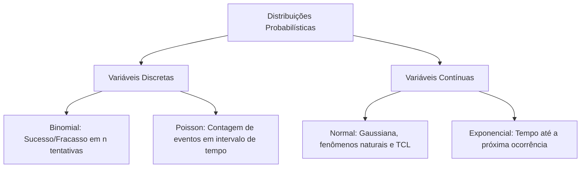
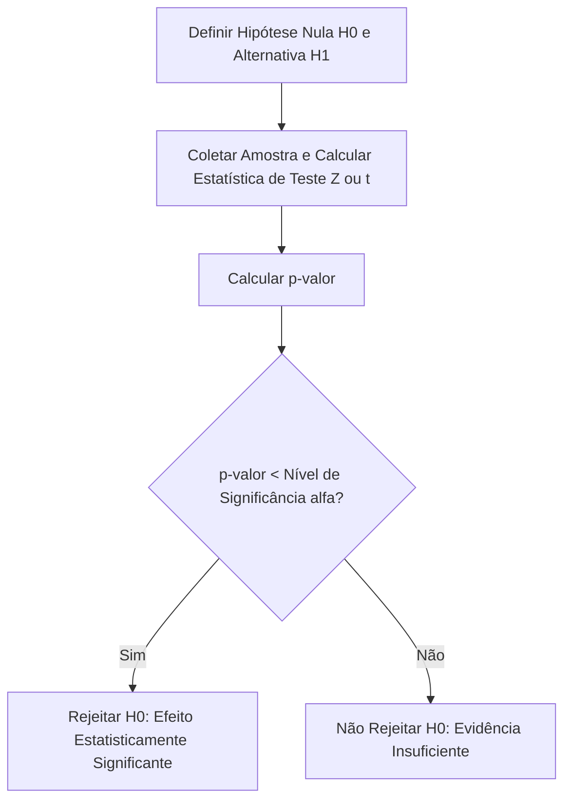

# 📊 Caderno Temático 01: Revisão de Estatística

> **Link do Caderno no Google NotebookLM:**  
> 🔗 [https://notebook.google.com/notebook/82a3d108-fbb7-418f-9ff6-beb5de0319f9?authuser=4](https://notebook.google.com/notebook/82a3d108-fbb7-418f-9ff6-beb5de0319f9?authuser=4)  
> **Fontes Anexadas:** OpenStax Statistics 2e, IME-USP, NIST Handbook, MIT OCW 18.05.

---

## 🎯 Sumário do Caderno

1. [Visão Geral e Importância](#1-visão-geral-e-importância)
2. [Estatística Descritiva](#2-estatística-descritiva)
3. [Teoria de Probabilidade e Teorema de Bayes](#3-teoria-de-probabilidade-e-teorema-de-bayes)
4. [Distribuições Probabilísticas Fundamentais](#4-distribuições-probabilísticas-fundamentais)
5. [Teorema Central do Limite e Inferência](#5-teorema-central-do-limite-e-inferência)
6. [Testes de Hipótese e Tomada de Decisão](#6-testes-de-hipótese-e-tomada-de-decisão)
7. [Correlação e Regressão Linear](#7-correlação-e-regressão-linear)
8. [Glossário Conceitual de Estatística](#8-glossário-conceitual-de-estatística)
9. [Prompts Especializados para Revisão](#9-prompts-especializados-para-revisão)

---

## 1. Visão Geral e Importância

A Estatística é a linguagem fundamental da tomada de decisão sob incerteza. Para profissionais de Sistemas de Informação, Ciência da Computação e Inteligência Artificial, ela é a base sobre a qual se estruturam:
- A avaliação de telemetria e desempenho de servidores (percentis de latência, vazão, disponibilidade).
- A validação científica de experimentos de produto (Testes A/B, métricas de engajamento).
- O funcionamento interno de algoritmos de Machine Learning (funções de custo, gradientes, distribuições a priori e a posteriori).

Através da curadoria no Google NotebookLM, organizamos conceitos dispersos em uma estrutura unificada e verificável.

---

## 2. Estatística Descritiva

A estatística descritiva visa sintetizar, organizar e descrever as características de um conjunto de dados.

### 2.1 Medidas de Tendência Central

- **Média Aritmética ($\bar{x}$ ou $\mu$):**  
  Ponto de equilíbrio dos dados.
  $$\bar{x} = \frac{1}{n} \sum_{i=1}^n x_i$$
  *Atenção:* É extremamente sensível a valores discrepantes (*outliers*).

- **Mediana ($\tilde{x}$ ou $Md$):**  
  O valor central que divide a amostra ordenada em duas metades de 50%.
  *Vantagem:* É uma medida robusta a outliers. Em medições de latência de software, a mediana (p50) costuma ser muito mais representativa da experiência do usuário do que a média.

- **Moda ($Mo$):**  
  O valor ou categoria com maior frequência absoluta observada nos dados.

### 2.2 Medidas de Dispersão e Variabilidade

- **Variância Populacional ($\sigma^2$) e Amostral ($s^2$):**  
  Mede a média dos desvios quadráticos em relação à média.
  $$\sigma^2 = \frac{1}{N} \sum_{i=1}^N (x_i - \mu)^2 \quad \text{(População)}$$
  $$s^2 = \frac{1}{n - 1} \sum_{i=1}^n (x_i - \bar{x})^2 \quad \text{(Amostra - Correção de Bessel)}$$

- **Desvio Padrão ($\sigma$ ou $s$):**  
  Raiz quadrada da variância. Retorna a dispersão para a mesma unidade física dos dados originais ($s = \sqrt{s^2}$).

- **Intervalo Interquartil ($IQR$):**  
  Diferença entre o terceiro quartil ($Q_3$, percentil 75) e o primeiro quartil ($Q_1$, percentil 25).
  $$IQR = Q_3 - Q_1$$
  *Critério de Outliers de Tukey:* Um dado é considerado outlier se estiver fora do intervalo:
  $$[Q_1 - 1.5 \cdot IQR, \quad Q_3 + 1.5 \cdot IQR]$$

---

## 3. Teoria de Probabilidade e Teorema de Bayes

A probabilidade quantifica a plausibilidade de ocorrência de um evento em um espaço amostral $\Omega$.

### 3.1 Axiomas e Regras Fundamentais
- **Probabilidade Total:** $0 \le P(A) \le 1$ e $P(\Omega) = 1$.
- **Regra da Adição:** $P(A \cup B) = P(A) + P(B) - P(A \cap B)$. Se forem mutuamente exclusivos, $P(A \cap B) = 0$.
- **Probabilidade Condicional:** A probabilidade de $A$ ocorrer dado que $B$ já ocorreu:
  $$P(A \mid B) = \frac{P(A \cap B)}{P(B)}, \quad \text{para } P(B) > 0$$
- **Independência:** Dois eventos $A$ e $B$ são estatisticamente independentes se, e somente se:
  $$P(A \cap B) = P(A) \cdot P(B) \iff P(A \mid B) = P(A)$$

### 3.2 O Teorema de Bayes

O Teorema de Bayes permite atualizar nossa crença sobre uma hipótese à medida que novas evidências são coletadas:

$$P(A \mid B) = \frac{P(B \mid A) \cdot P(A)}{P(B)}$$

Onde:
- $P(A)$ é o **Prior** (probabilidade a priori da hipótese).
- $P(B \mid A)$ é a **Verossimilhança** (Likelihood: quão provável é observar a evidência $B$ assumindo que $A$ é verdadeiro).
- $P(B)$ é a **Evidência Marginal** ($P(B) = \sum P(B \mid A_i) P(A_i)$).
- $P(A \mid B)$ é o **Posterior** (crença atualizada após observar a evidência).

> **Exemplo Prático em TI:** Classificadores Naive Bayes em filtros antispam e sistemas de monitoramento de anomalias que inferem a probabilidade de um servidor estar com disco corrompido dado que alarmes intermitentes de I/O dispararam.

---

## 4. Distribuições Probabilísticas Fundamentais



### 4.1 Distribuição Normal (Gaussiana)
- Notação: $X \sim \mathcal{N}(\mu, \sigma^2)$.
- Formato de sino simétrico em torno da média $\mu$.
- **Escore Z (Padronização):** Converte qualquer normal para a normal padrão $\mathcal{N}(0, 1)$:
  $$Z = \frac{X - \mu}{\sigma}$$
- **Regra Empírica (68 - 95 - 99.7):**
  - ~68.2% dos dados caem entre $[\mu - \sigma, \mu + \sigma]$.
  - ~95.4% dos dados caem entre $[\mu - 2\sigma, \mu + 2\sigma]$.
  - ~99.7% dos dados caem entre $[\mu - 3\sigma, \mu + 3\sigma]$.

### 4.2 Distribuição de Poisson
Modela o número de ocorrências de um evento raro ou independente em um intervalo fixo de tempo ou espaço:
$$P(X = k) = \frac{\lambda^k e^{-\lambda}}{k!}$$
- Parâmetro $\lambda$: taxa média de eventos no intervalo. Na Poisson, a média é igual à variância: $E[X] = Var(X) = \lambda$.
- *Aplicação:* Quantidade de requisições HTTP recebidas por um servidor web por segundo.

### 4.3 Distribuição Exponencial
Modela o tempo transcorrido entre eventos sucessivos em um processo de Poisson:
$$f(x) = \lambda e^{-\lambda x}, \quad x \ge 0$$
- Possui a propriedade de **falta de memória** (*memoryless*).
- *Aplicação:* Tempo até a ocorrência da próxima falha de hardware (MTBF - Mean Time Between Failures).

---

## 5. Teorema Central do Limite e Inferência

O **Teorema Central do Limite (TCL)** é considerado a espinha dorsal de toda a inferência estatística clássica.

> **Enunciado:** Seja $X_1, X_2, \dots, X_n$ uma amostra aleatória simples de tamanho $n$ retirada de qualquer população com média $\mu$ e variância finita $\sigma^2$ (independentemente da forma da distribuição original). À medida que o tamanho da amostra $n$ aumenta (geralmente $n \ge 30$), a distribuição amostral da média $\bar{X}$ aproxima-se de uma Distribuição Normal:
> $$\bar{X} \xrightarrow{d} \mathcal{N}\left(\mu, \frac{\sigma^2}{n}\right)$$

### Erro Padrão da Média ($SE$)
O desvio padrão da distribuição amostral das médias:
$$SE = \frac{\sigma}{\sqrt{n}} \approx \frac{s}{\sqrt{n}}$$

### Intervalos de Confiança (IC)
Para um nível de confiança $(1 - \alpha)$, o intervalo para a média populacional é dado por:
$$IC = \left[ \bar{x} - Z_{\alpha/2} \cdot \frac{s}{\sqrt{n}}, \quad \bar{x} + Z_{\alpha/2} \cdot \frac{s}{\sqrt{n}} \right]$$
- Para 95% de confiança: $Z_{0.025} \approx 1.96$.

---

## 6. Testes de Hipótese e Tomada de Decisão

Um teste de hipóteses avalia se uma alegação sobre um parâmetro populacional é sustentada pelos dados amostrais.



### 6.1 Hipóteses e Erros de Decisão
- **Hipótese Nula ($H_0$):** O status quo, a assunção de não-efeito ou ausência de diferença.
- **Hipótese Alternativa ($H_1$):** A hipótese de pesquisa ou alteração detectada.

| Realidade \ Decisão | Não Rejeitar $H_0$ | Rejeitar $H_0$ |
| :--- | :--- | :--- |
| **$H_0$ é Verdadeira** | Decisão Correta ($1 - \alpha$) | **Erro Tipo I ($\alpha$)** - Falso Positivo |
| **$H_0$ é Falsa** | **Erro Tipo II ($\beta$)** - Falso Negativo | Decisão Correta: Poder do Teste ($1 - \beta$) |

### 6.2 O $p$-valor Rigoroso
O **$p$-valor** é a probabilidade de se obter uma estatística de teste tão ou mais extrema do que a observada, assumindo que a hipótese nula $H_0$ é estritamente verdadeira:
$$p\text{-valor} = P(\text{Dados ou mais extremos} \mid H_0)$$
- Se $p\text{-valor} \le \alpha$ (comumente 0.05), rejeitamos $H_0$.

---

## 7. Correlação e Regressão Linear

### 7.1 Coeficiente de Correlação de Pearson ($r$)
Mede a força e a direção da relação linear entre duas variáveis quantitativas contínuas:
$$r = \frac{\sum (x_i - \bar{x})(y_i - \bar{y})}{\sqrt{\sum (x_i - \bar{x})^2 \sum (y_i - \bar{y})^2}}$$
- Varia de $-1$ (correlação linear negativa perfeita) a $+1$ (correlação linear positiva perfeita).
- $r = 0$ indica ausência de correlação linear (mas não ausência de relação não linear!).
- **Cuidado Fundamental:** *Correlação não implica Causalidade* (efeito de variáveis de confusão).

### 7.2 Regressão Linear Simples
Modela a relação entre uma variável independente $X$ e uma dependente $Y$:
$$\hat{y} = \beta_0 + \beta_1 x$$
- $\beta_1$: Coeficiente angular (quanto $Y$ varia para cada unidade acrescida em $X$).
- $\beta_0$: Intercepto (valor esperado de $Y$ quando $X = 0$).
- $R^2$ (Coeficiente de Determinação): Proporção da variabilidade total de $Y$ explicada pelo modelo linear ($0 \le R^2 \le 1$).

---

## 8. Glossário Conceitual de Estatística

| Conceito | Definição Formal | Aplicação Prática em TI / Engenharia de Software |
| :--- | :--- | :--- |
| **Outlier** | Ponto de dado que diverge acentuadamente do padrão geral da distribuição. | Picos anômalos de uso de CPU ou picos de latência (spikes) causados por garbage collection. |
| **Percentil (p95 / p99)** | Valor abaixo do qual se encontra uma determinada porcentagem das observações. | Acordo de Nível de Serviço (SLA): *"99% das requisições devem responder em menos de 200ms"*. |
| **Correção de Bessel** | Uso de $n-1$ no divisor da variância amostral para corrigir o viés em relação à média da amostra. | Estimativas não-viesadas de ruído e incerteza em telemetria e datasets de treino em ML. |
| **Teorema de Bayes** | Princípio de inversão de probabilidades condicionais através de evidência observada. | Filtros antispam de e-mail e cálculo de probabilidade a posteriori de falha de componentes. |
| **Erro Tipo I ($\alpha$)** | Rejeição indevida de uma hipótese nula que era verdadeira (falso alarme). | Disparar um alerta urgente de queda de sistema quando foi apenas uma oscilação momentânea de rede. |
| **Erro Tipo II ($\beta$)** | Falha em rejeitar uma hipótese nula que era falsa (omissão). | Não detectar uma degradação silenciosa no throughput do banco de dados. |
| **Poder do Teste ($1-\beta$)** | Probabilidade de detectar um efeito real quando ele de fato existe. | Dimensionamento da quantidade mínima de usuários necessários em um Teste A/B de checkout. |
| **$R^2$ (R-Quadrado)** | Medida de adequação do ajuste que quantifica a variância explicada pela regressão. | Validação da capacidade preditiva de um modelo linear de consumo de memória vs requisições simultâneas. |

---

## 9. Prompts Especializados para Revisão

Para continuar seus estudos neste caderno temático dentro do Google NotebookLM, copie e cole os seguintes prompts no chat da ferramenta:

```text
Prompt 1: "Com base no material do NIST Handbook e OpenStax, liste as premissas obrigatórias que devem ser verificadas antes de executar um teste t de Student e o que fazer se os dados violarem a normalidade."

Prompt 2: "Explique a diferença entre o Teorema Central do Limite e a Lei dos Grandes Números utilizando uma analogia simples e cite as seções das fontes que embasam a explicação."

Prompt 3: "Elabore um questionário de 3 perguntas com alternativas sobre Testes A/B e p-valor, incluindo o gabarito comentado ao final baseado no texto."
```
