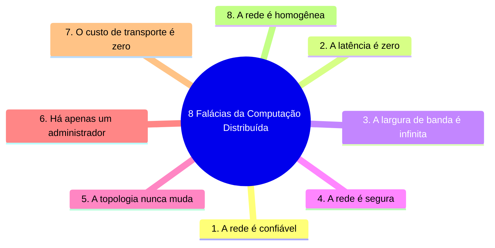
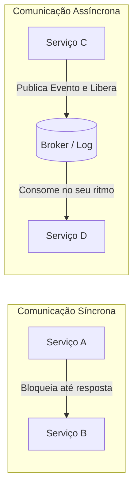
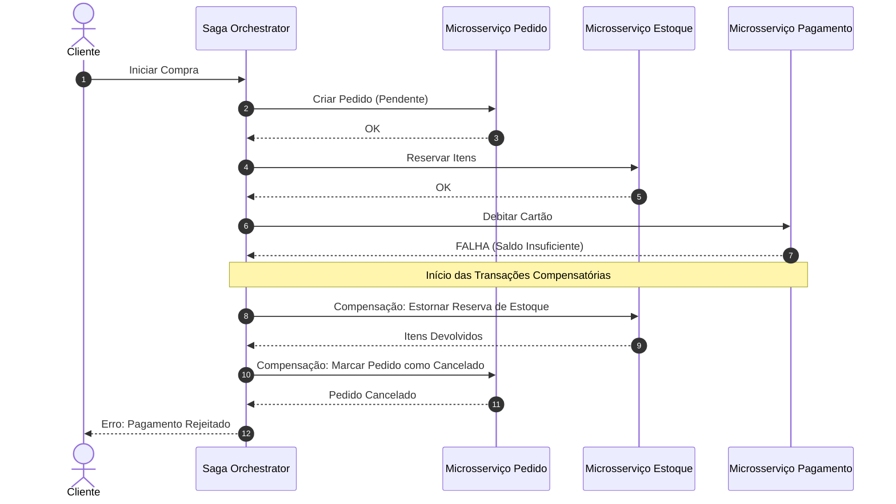
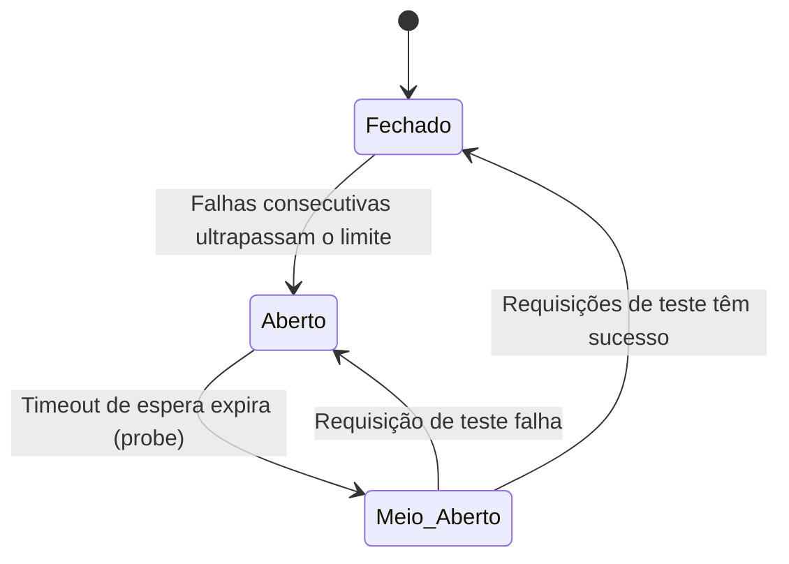

# 🌐 Caderno Temático 02: Desenvolvimento de Aplicações Distribuídas

> **Link do Caderno no Google NotebookLM:**  
> 🔗 [https://notebook.google.com/notebook/41e49dc5-f5e8-4b07-92ef-5c995a6fa3aa?authuser=4](https://notebook.google.com/notebook/41e49dc5-f5e8-4b07-92ef-5c995a6fa3aa?authuser=4)  
> **Fontes Anexadas:** Tanenbaum DS4, Microsoft Cloud Patterns, Martin Fowler Patterns, Confluent Designing Event-Driven Systems.

---

## 🎯 Sumário do Caderno

1. [Fundamentos e as 8 Falácias da Computação Distribuída](#1-fundamentos-e-as-8-falácias-da-computação-distribuída)
2. [Teoremas de Consistência: CAP e PACELC](#2-teoremas-de-consistência-cap-e-pacelc)
3. [Comunicação Inter-serviços: Síncrona vs Assíncrona](#3-comunicação-inter-serviços-síncrona-vs-assíncrona)
4. [Mensageria e Arquitetura Orientada a Eventos (EDA)](#4-mensageria-e-arquitetura-orientada-a-eventos-eda)
5. [Consistência e Transações em Microsserviços (Saga e Outbox)](#5-consistência-e-transações-em-microsserviços-saga-e-outbox)
6. [Padrões de Resiliência e Tolerância a Falhas](#6-padrões-de-resiliência-e-tolerância-a-falhas)
7. [Observabilidade Distribuída e Tracing](#7-observabilidade-distribuída-e-tracing)
8. [Glossário Conceitual de Sistemas Distribuídos](#8-glossário-conceitual-de-sistemas-distribuídos)
9. [Prompts Especializados para Revisão](#9-prompts-especializados-para-revisão)

---

## 1. Fundamentos e as 8 Falácias da Computação Distribuída

Um **Sistema Distribuído** é uma coleção de nós computacionais autônomos que se comunicam através de uma rede e se apresentam aos usuários finais como um sistema único e coerente (Tanenbaum & Van Steen).

Ao projetar sistemas modernos baseados em microsserviços ou nuvem, os engenheiros frequentemente caem nas **8 Falácias da Computação Distribuída** (cunhadas por Peter Deutsch e engenheiros da Sun Microsystems):



### Impacto Prático de Ignorar as Falácias
- Assumir latência zero leva a arquiteturas "chatty" com dezenas de chamadas síncronas em cascata, degradando o tempo total de resposta ($T_{total} = \sum T_{servicos}$).
- Ignorar falhas na rede resulta em serviços que travam indefinidamente aguardando conexões TCP sem timeout configurado.

---

## 2. Teoremas de Consistência: CAP e PACELC

### 2.1 O Teorema CAP (Brewer)
Em qualquer sistema distribuído de dados, é matematicamente impossível garantir simultaneamente as três propriedades:
1. **Consistência (C - Linearizabilidade):** Toda leitura recebe a escrita mais recente ou um erro.
2. **Disponibilidade (A):** Todo nó não-falho responde a requisições sem erros, mesmo que o dado esteja desatualizado.
3. **Tolerância a Partição (P):** O sistema continua funcionando mesmo se a comunicação de rede entre nós for interrompida ou dividida.

> **O Fato Inegável:** Como redes físicas inevitavelmente sofrem partições (switches caem, cabos rompem, delays de GC ocorrem), o $P$ é obrigatório. A escolha em tempo de falha é estritamente entre **CP** (abrir mão de disponibilidade para não ter dados divergentes) ou **AP** (abrir mão de consistência forte para manter o serviço respondendo).

### 2.2 O Teorema PACELC (Daniel Abadi)
O CAP analisa apenas o que acontece quando **há partição**. O PACELC completa a lacuna analisando o que acontece quando a rede está saudável:

$$\text{Se } \mathbf{P} \text{ (Partição)} \implies \text{Escolha entre } \mathbf{A} \text{ ou } \mathbf{C}; \quad \text{Else } \mathbf{E} \text{ (Normalidade)} \implies \text{Escolha entre } \mathbf{L} \text{ (Latência) ou } \mathbf{C} \text{ (Consistência)}$$

| Sistema | Classificação PACELC | Comportamento na Partição | Comportamento na Normalidade |
| :--- | :---: | :--- | :--- |
| **Apache Cassandra** | **PA / EL** | Aceita escritas/leituras em qualquer nó (AP) | Resposta ultra-rápida sem consenso síncrono (Latência baixa) |
| **MongoDB (Default)** | **PC / EC** | Recusa escritas até eleger novo líder (CP) | Réplicas confirmam escritas para evitar leitura suja (Consistência) |
| **CockroachDB / Spanner** | **PC / EC** | Consenso Raft/Paxos estrito (CP) | Sincronização síncrona com latência de consenso |

---

## 3. Comunicação Inter-serviços: Síncrona vs Assíncrona



### 3.1 REST sobre HTTP/1.1 vs HTTP/2
- **REST / JSON:** Padrão universal, legível por humanos, semântica declarativa via verbos HTTP (`GET`, `POST`, `PUT`, `DELETE`).  
  *Desvantagens:* Payload textual verboso, overhead de headers repetidos, head-of-line blocking no HTTP/1.1.

### 3.2 gRPC e Protocol Buffers (Protobuf)
- Desenvolvido pelo Google, opera sobre HTTP/2 com serialização binária compacta.
- **Vantagens:** Contratos fortemente tipados em arquivos `.proto`, multiplexação de conexões (várias requisições na mesma conexão TCP), suporte a streaming bidirecional e velocidade de 5 a 10 vezes superior ao JSON.
- **Uso Recomendado:** Comunicação interna de altíssima vazão e baixa latência entre microsserviços dentro do mesmo cluster.

---

## 4. Mensageria e Arquitetura Orientada a Eventos (EDA)

A comunicação desacoplada via mensageria permite tolerar indisponibilidades temporárias de serviços consumidores (amortecimento de carga).

### RabbitMQ vs Apache Kafka

| Característica | RabbitMQ (Message Broker Tradicional) | Apache Kafka (Distributed Append-Only Log) |
| :--- | :--- | :--- |
| **Modelo Conceitual** | Fila inteligente e Broker ativo (Smart Broker, Dumb Consumer) | Log imutável particionado (Dumb Broker, Smart Consumer) |
| **Roteamento** | Exchanges avançadas (Direct, Topic, Fanout, Headers) | Baseado em Chaves de Particionamento (Key Partitioning) |
| **Ciclo de Vida da Mensagem**| Deletada da fila assim que o consumidor envia o `ack` | Mantida em disco por tempo configurável (dias/meses), permitindo replay |
| **Vazão (Throughput)** | Dezenas de milhares de mensagens/segundo | Milhões de eventos/segundo por nó |
| **Caso de Uso Ideal** | Filas de background jobs, tarefas transacionais de envio de e-mails | Pipelines de dados em tempo real, Event Sourcing, Analytics, CDC |

---

## 5. Consistência e Transações em Microsserviços

Em sistemas monolíticos, as transações são regidas pelo padrão **ACID** do banco relacional. Em microsserviços desacoplados com bancos próprios (*Database-per-service*), passamos para o modelo **BASE**:
- **B**asically **A**vailable (Disponibilidade básica).
- **S**oft state (O estado pode mudar mesmo sem novas entradas devido à propagação).
- **E**ventual consistency (Consistência eventual: o sistema se tornará consistente após um intervalo de tempo).

### 5.1 O Padrão Saga
Substitui o Two-Phase Commit (2PC) por uma série de transações locais encadeadas:



### 5.2 O Padrão Transactional Outbox
Evita o problema clássico de inconsistência ao tentar gravar no banco de dados e publicar no Kafka ao mesmo tempo (o chamado *Dual-Write Problem*).  
Uma tabela `outbox` é salva na **mesma transação local ACID** do banco do serviço; um processo em segundo plano (como o Debezium via CDC) lê o log de transações do banco e despacha a mensagem com segurança para o broker.

---

## 6. Padrões de Resiliência e Tolerância a Falhas

Baseados no *Microsoft Cloud Design Patterns*, estes padrões garantem que a falha de um nó não derrube a plataforma inteira.

### 6.1 Circuit Breaker Pattern (Disjuntor)
Protege os serviços consumidores de ficarem esperando respostas de dependências fora do ar:


- **Closed (Fechado):** Fluxo normal. Requisições trafegam livremente.
- **Open (Aberto):** Disjuntor desarma. Requisições são rejeitadas imediatamente (*Fail Fast*) ou direcionadas para um fallback sem onerar o serviço destino.
- **Half-Open (Meio-Aberto):** Permite um número controlado de requisições de teste para validar se o serviço dependente se recuperou.

### 6.2 Retry com Exponential Backoff e Jitter
- **Exponential Backoff:** Aumenta o tempo de espera a cada tentativa falha ($2^n \cdot base$).
- **Jitter (Ruído Aleatório):** Adiciona uma variação aleatória de milissegundos ao tempo de espera para evitar o efeito "tempestade de retentativas" (*Retry Storm*), onde milhares de clientes disparam requisições no mesmo segundo exato.

### 6.3 Bulkhead Pattern (Compartimentação)
Inspirado nas anteparas estanques dos navios que evitam que o navio todo afunde caso um compartimento seja inundado.  
*Aplicação:* Separar pools de threads e conexões dedicadas para clientes críticos ou integrações com parceiros externos lentos.

---

## 7. Observabilidade Distribuída e Tracing

Em uma rede com dezenas de microsserviços, um único clique do usuário pode disparar 15 chamadas HTTP e eventos assíncronos. A observabilidade requer os **Três Pilares**:

1. **Métricas:** Séries temporais numéricas de saúde agregada (Padrão RED: *Rate*, *Errors*, *Duration*).
2. **Logs Estruturados:** Registros em formato JSON com campos padronizados (`timestamp`, `service_name`, `log_level`, `trace_id`).
3. **Distributed Tracing (OpenTelemetry):**  
   - **Trace ID:** Identificador global único atribuído no ponto de entrada (API Gateway) e propagado em cada chamada via cabeçalho HTTP (`traceparent` no padrão W3C).
   - **Span ID:** Identifica uma etapa individual de processamento executada por um serviço específico dentro daquele trace.

---

## 8. Glossário Conceitual de Sistemas Distribuídos

| Conceito | Definição Formal | Impacto na Arquitetura |
| :--- | :--- | :--- |
| **Split-Brain** | Estado em que nós de um cluster perdem comunicação entre si e ambos acreditam ser os líderes autoritativos. | Pode causar perda irreversível ou corrupção de dados por escritas conflitantes. |
| **Linearizabilidade** | Garantia de consistência forte onde toda operação de leitura parece acontecer instantaneamente no tempo real. | Exige protocolos de consenso (Raft/Paxos) com impacto direto na latência de escrita. |
| **Idempotência** | Propriedade pela qual uma operação pode ser executada múltiplas vezes sem alterar o resultado além da primeira execução. | Indispensável em filas com entrega *at-least-once*, onde mensagens duplicadas são inevitáveis. |
| **Dead Letter Queue (DLQ)** | Fila especial para onde são direcionadas mensagens que falharam repetidamente no processamento. | Evita que uma "mensagem envenenada" trave o consumidor em um loop infinito de erros. |
| **CDC (Change Data Capture)** | Mecanismo que monitora os logs de escrita de um banco para emitir eventos de mudança em tempo real. | Viabiliza o padrão Transactional Outbox e sincronização de índices de busca (ex.: Elasticsearch). |
| **Circuit Breaker** | Padrão que interrompe chamadas a um serviço instável para permitir sua recuperação e evitar travamento em cadeia. | Elimina falhas em cascata e degradação generalizada de latência na malha de microsserviços. |
| **Context Propagation** | Técnica de injetar e extrair metadados de rastreamento (Trace ID/Span ID) através de protocolos de rede. | Permite que ferramentas como Jaeger e Zipkin desenhem a cascata de chamadas ponta a ponta. |

---

## 9. Prompts Especializados para Revisão

Copie e cole estes prompts diretamente no chat do seu caderno no Google NotebookLM:

```text
Prompt 1: "Com base no livro de Tanenbaum e no catálogo da Microsoft, elabore um comparativo entre Consistência Sequencial e Consistência Eventual, citando um exemplo prático de aplicação para cada uma."

Prompt 2: "Explique como o protocolo de consenso Raft elege um novo líder após uma falha de rede e cite as seções do material de Martin Fowler que tratam do algoritmo."

Prompt 3: "Atue como um Arquiteto de Software e avalie um cenário onde um e-commerce precisa processar pagamentos na Black Friday: quais padrões de resiliência devem ser combinados para evitar que falhas no gateway de pagamento derrubem o catálogo de produtos?"
```
